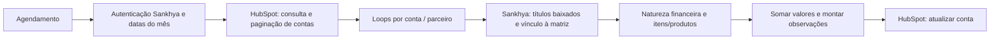
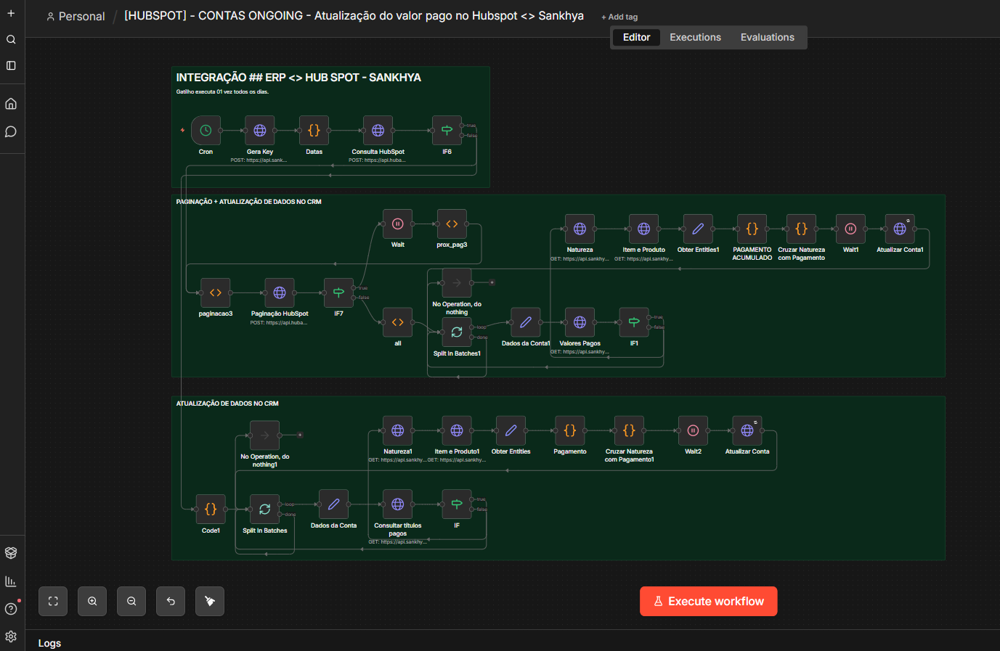

# Visão financeira para CS — ERP Sankhya → HubSpot

Desenvolvi esta integração com **n8n, APIs do ERP Sankhya e HubSpot, critérios SQL, paginação e consolidação em JavaScript** para aproximar o acompanhamento financeiro da rotina de Customer Success.

## O problema que procurei resolver

O time de CS precisava perguntar ao Financeiro sobre pagamentos e entender quais produtos e contratos compunham o faturamento de cada cliente. Construí uma rotina para consultar baixas no ERP, cruzar informações por parceiro/matriz e atualizar valores, datas e observações no CRM.

Aprender a usar expressões e subconsultas SQL dentro das requisições da API foi uma parte importante do desafio. A solução combina consulta ao ERP, leitura paginada de contas do CRM e tratamento de respostas com um ou vários registros.

Na minha experiência operacional, a atualização podia ocorrer em aproximadamente um minuto. Não publico esse tempo como benchmark ou garantia de 59 segundos.

## Fluxo

## Escopo observado no export

A consulta busca receitas baixadas no mês corrente. Os dois caminhos de atualização encontrados gravam **Adimplente**. A intenção operacional era dar visibilidade financeira a CS, mas esse arquivo não demonstra uma rotina completa para marcar inadimplência ou situação ativa/inativa.

O cron exportado é **00 01 * * *** — 01:00 no fuso da instância, que não está informado no JSON. Na rotina que descrevi, o horário era 08:00; essa diferença foi mantida explícita, sem alterar o agendamento original silenciosamente.

## Screenshot

## Explore

- [Template inativo de 39 nós](workflows/workflow.template.json)
- [Critérios SQL e requisições ao ERP](docs/consultas-erp.md)
- [Agregação e natureza/produto](docs/consolidacao.md)
- [Paginação, rotina e reprocessamento](docs/rotina.md)
- [Inventário e código](docs/inventario.md)
- [Configuração](docs/configuracao.md)
- [Preparação pública](docs/publicacao.md)
- [Validação](docs/validacao.md)
- [Projeto complementar: cadastro de cliente no ERP](https://github.com/alosiolemos/n8n-hubspot-sankhya-customer-onboarding)

Credenciais e dados de clientes não acompanham o template. Não houve execução de consultas no ERP ou atualização do CRM nesta preparação.
